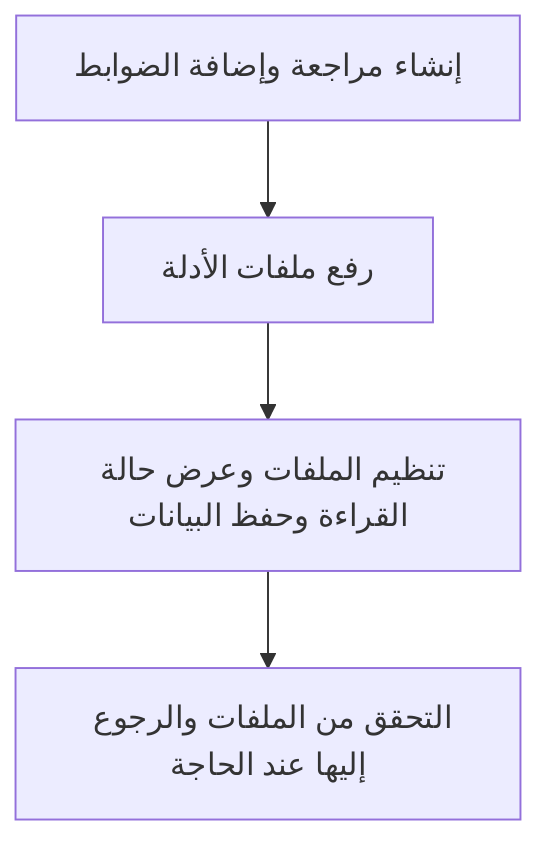

# Cybersecurity Audit Evidence Reviewer

أداة تنظيم وإدارة أدلة التدقيق السيبراني | نموذج أولي

## 1. نظرة عامة

يهدف المشروع إلى تنظيم المراجعات والضوابط السيبرانية والأدلة المرتبطة بها في مساحة عمل واحدة، لتسهيل حفظها والرجوع إليها وتقليل تشتت الملفات. تم اختيار مراجعة صلاحيات المستخدمين (UAR) كحالة تطبيقية باستخدام بيانات اصطناعية.

- **المسار:** الإنتاجية باستخدام الذكاء الاصطناعي وأتمتة سير العمل (Workflow Automation).
- **التطبيق المعتمد:** نموذج ويب مبني ومنشور باستخدام Etlaq.
- **النتيجة الفعلية:** قبول ثلاثة ملفات أدلة، وإضافة أكثر من ضابط، والاحتفاظ بالضوابط والأدلة بعد تحديث الصفحة، وإظهار تعذر القراءة عند رفع ملف Word فارغ.
- **الأثر المتوقع:** توفير 20 دقيقة لكل مراجعة (33.3%)، وفق تقدير أولي لسير المراجعة الكامل من 60 إلى 40 دقيقة، وليس قياسًا فعليًا لنطاق التنظيم الحالي.

[فتح التطبيق التجريبي](https://www.etlaq.sa/api/deploy/open-live?chatId=15fb2ab3-a006-416d-a76f-0eb50116922a)

## 2. ملفات المستودع

الهيكل المقترح لإرفاق ملفات المشروع المتوفرة عند رفعها إلى GitHub:

```text
README.md
PRD.md
SPEC.md
AGENTS.md
UI_DESIGN.md
TEST_CASES.md
capstone.html
my_productivity_kit.xlsx
Cybersecurity_Audit_Evidence_Reviewer_Project_Board.pdf
sample_data/
  01_Control_Requirement_UAR.docx
  02_Evidence_User_Access_Review_Report.docx
  03_Evidence_Active_User_Listing.docx
  04_Evidence_Manager_Approval_Record.docx
```

تتضمن الملفات متطلبات المشروع ومواصفاته وتصميم الواجهات وحالات الاختبار وسجل الإنتاجية ولوحة المشروع والبيانات التجريبية. يضاف ملف Word فارغ عند إعادة اختبار الحالة الحدية. هذه قائمة الإرفاق المطلوبة، وليست تأكيدًا بأن الملفات رُفعت إلى المستودع بالفعل.

## 3. سير العمل



ينفذ المدقق الخطوتين الأولى والثانية، ويتولى التطبيق تنظيم البيانات وحفظها وعرض حالة القراءة، ثم يتحقق المدقق من الملفات والضوابط.

## 4. بطاقة التفويض ومعيار القبول

| العنصر | التفاصيل |
|---|---|
| المفوض | إعداد المواصفات وبناء الأداة بمساعدة الذكاء الاصطناعي، وتنظيم البيانات وحفظها بواسطة التطبيق. |
| المحتفظ به | تحديد نطاق المراجعة واختيار الأدلة والتحقق من صحتها وكفايتها واتخاذ القرار المهني. |
| البيانات | متطلب ضابط UAR وثلاثة مستندات أدلة اصطناعية. |
| معيار القبول | إنشاء المراجعات وإضافة الضوابط ورفع الأدلة وحفظها بعد تحديث الصفحة، وإظهار تعذر القراءة عند عدم إمكانية استخراج المحتوى. |
| إعادة الاستخدام | مواصفات PRD وSPEC وتعليمات المشروع وسجل الإنتاجية. |

## 5. التطبيقات والأدوات المستخدمة

| الأداة | الاستخدام |
|---|---|
| Gemini | التخطيط وإعداد المتطلبات والمواصفات وملفات الاختبار والبيانات التجريبية. |
| Etlaq | بناء تطبيق الويب وتصميم الواجهات وتنفيذ الوظائف ونشر النموذج الأولي. |
| Word | إعداد ملفات الأدلة الاصطناعية واختبار الملف الفارغ. |
| GitHub | المستودع المخصص لتوثيق المشروع وإرفاق ملفاته. |

## 6. إعادة التجربة وطريقة الاستخدام

1. افتح رابط التطبيق التجريبي في المتصفح.
2. أنشئ مراجعة باسم `UAR – Finance – Q3 2026`.
3. أضف الضابط `UAR-01` باسم `Quarterly User Access Review`، واستخدم المتطلب الوارد في ملف `01_Control_Requirement_UAR.docx`.
4. ارفع ملفات الأدلة الثلاثة (02 و03 و04) ضمن المراجعة. ملف 01 يمثل المتطلب وليس دليلًا.
5. تحقق من ظهور أسماء الملفات وحالة الجاهزية (Ready).
6. أضف ضابطًا آخر باسم `Access Provisioning and Authorization` ومعرف `IAM-02` لاختبار تعدد الضوابط.
7. حدّث الصفحة (Refresh) وتحقق من بقاء الضوابط والأدلة.
8. أنشئ مراجعة اختبار باسم `Edge Case Test – Empty Evidence` وأضف ضابطًا تجريبيًا، ثم ارفع ملف Word فارغًا وتحقق من ظهور تعذر القراءة وعدم استخراج محتوى.
9. راجع الملفات الأصلية وتأكد من صحتها، ووثّق نتائج الاختبار في سجل الإنتاجية.

لا تتطلب إعادة التجربة من خلال الرابط المنشور إعداد بيئة تطوير محلية. لم تُتحقق هنا خطوات تشغيل الشيفرة المصدرية محليًا أو توفر الرابط حاليًا.

## 7. الاختبارات والنتائج

| الحالة | الاختبار | النتيجة الفعلية |
|---|---|---|
| Normal | إنشاء مراجعة وإضافة أكثر من ضابط ورفع ثلاثة ملفات والتحقق بعد Refresh. | ناجح: ظهرت أسماء الملفات وحالة Ready وبقيت الضوابط والأدلة. |
| Messy | رفع ملفات غير منظمة أو ناقصة البيانات. | لم يُختبر بعد. |
| Edge | رفع ملف Word فارغ. | ناجح: ظهر تعذر القراءة ولم يُستخرج محتوى. |

نجحت الوظائف الأساسية التي جرى اختبارها. حالة Ready لا تعني أن الدليل كافٍ أو صحيح مهنيًا.

### قياس الإنتاجية قبل وبعد

| المؤشر | القيمة |
|---|---|
| قبل استخدام الحل | 60 دقيقة — تقدير أولي لسير المراجعة الكامل. |
| بعد استخدام الحل | 40 دقيقة — مستهدف تقديري. |
| التوفير المتوقع | 20 دقيقة (33.3%) لكل مراجعة. |
| التوفير الشهري المتوقع | 80 دقيقة عند أربع مراجعات شهريًا. |
| المؤشر الثاني | استمرارية حفظ الضوابط والأدلة بعد تحديث الصفحة — نجح الاختبار. |

الأرقام الزمنية ليست نتائج قياس فعلي للنطاق الحالي. لقياس الأثر، تُنفذ مهمة تنظيم الأدلة واسترجاعها يدويًا ثم باستخدام التطبيق على نفس مجموعة الملفات، مع احتساب وقت التحقق والتصحيح وتسجيل الزمن الفعلي لكل تجربة.

## 8. المخاطر والضوابط والإفصاح

| الخطر | الضابط |
|---|---|
| فقد الأدلة | التحقق من الحفظ بعد تحديث الصفحة والاحتفاظ بالملفات الأصلية. |
| الاعتماد على ملف غير مقروء | التحقق من حالة القراءة والرجوع إلى المستند الأصلي. |
| كشف معلومات حساسة | استخدام بيانات اصطناعية فقط وعدم رفع بيانات العمل أو الموظفين أو كلمات المرور أو المستندات غير المصرح بها. |
| الاعتماد على حالة الجاهزية وحدها | إبقاء التحقق من صحة الأدلة وكفايتها والقرار المهني لدى المدقق. |

**الإفصاح:** استُخدم الذكاء الاصطناعي في التخطيط وبناء النموذج الأولي، وتبقى مسؤولية التحقق والقرار النهائي لدى المدقق الداخلي.

## 9. التحسينات المستقبلية وخطة 30 يومًا

| الفترة | الإجراء |
|---|---|
| اليوم الأول | توثيق نتائج الاختبارات الحالية. |
| الأسبوع الأول | استكمال اختبار Messy وقياس وقت تنظيم الأدلة واسترجاعها قبل استخدام التطبيق وبعده. |
| نهاية الشهر | تجربة ضوابط إضافية وجمع ملاحظات المستخدمين وتحسين تجربة الاستخدام وقياس الأثر. |

**القرار بعد 30 يومًا:** التوسع في استخدام الأداة إذا أثبتت قيمة قابلة للقياس مع الحفاظ على جودة العمل.

## 10. أكاديمية سدايا

[أكاديمية سدايا – SDAIA Academy على GitHub](https://github.com/SDAIAAcademy)
